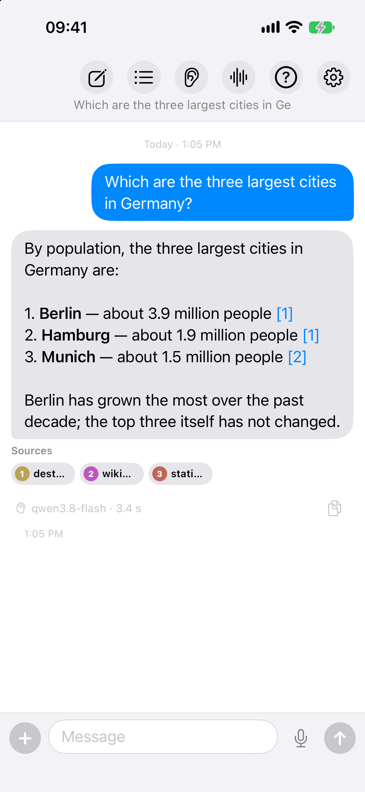
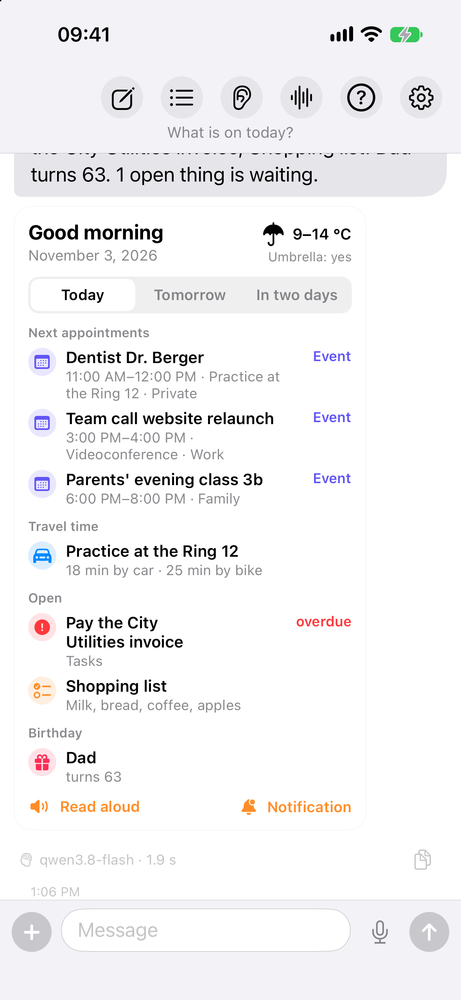
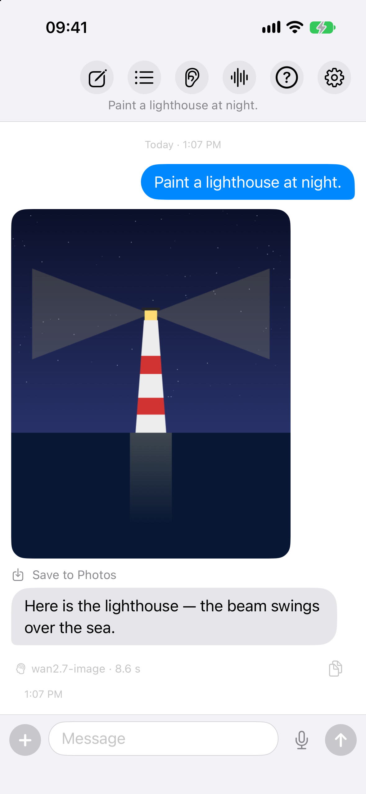
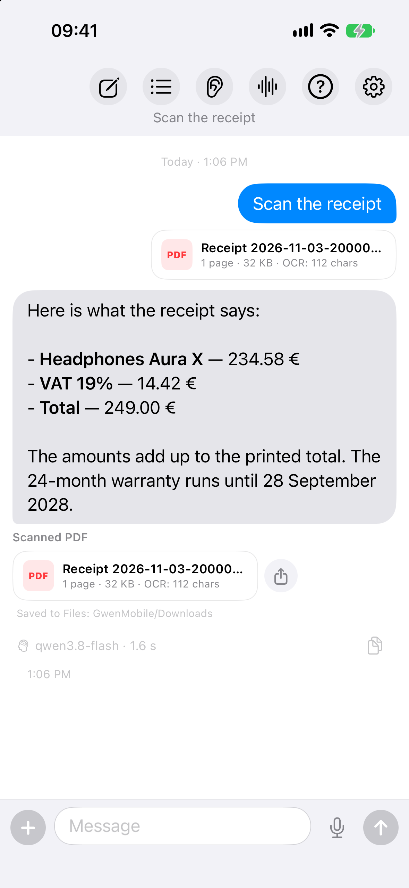
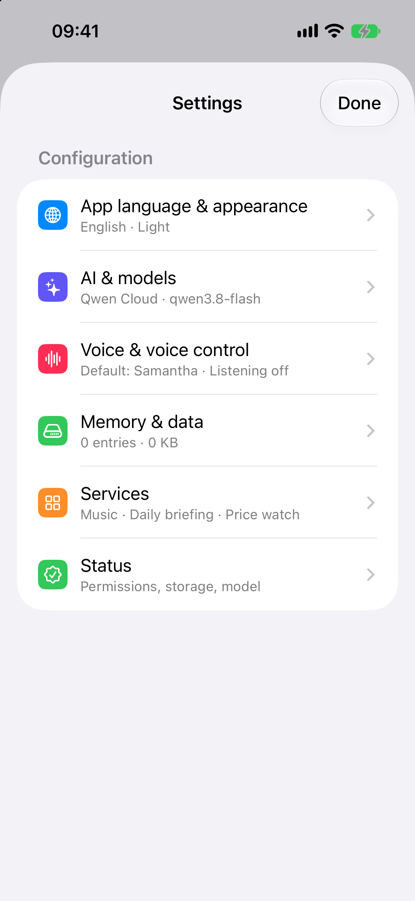
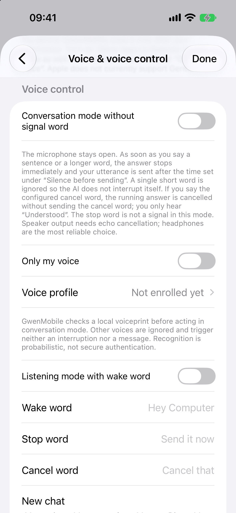
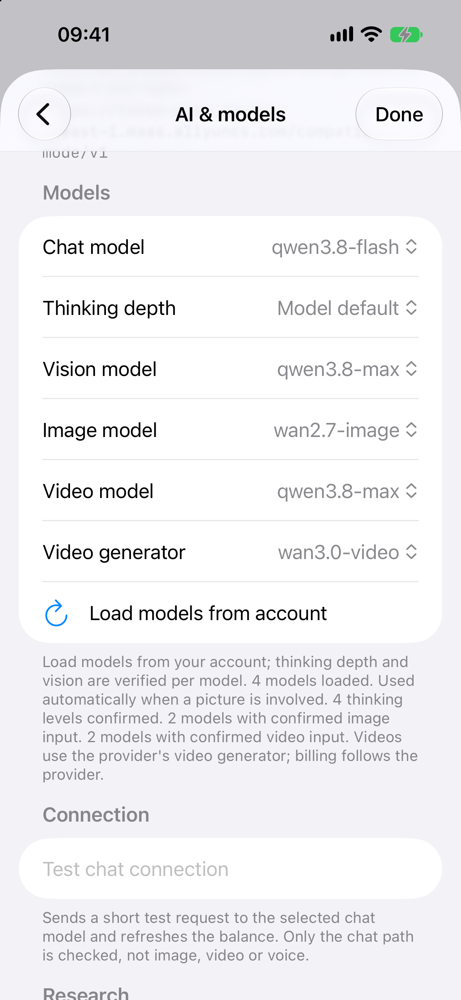
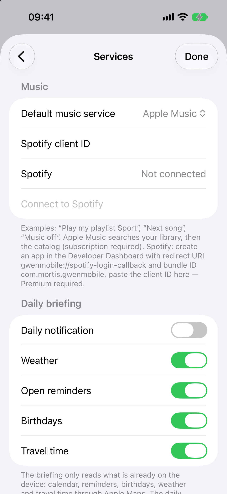

# GwenMobile

A personal AI assistant for iPhone, iPad and Mac that does the work instead of only answering: it researches the web,
draws and edits pictures, creates videos, compares prices, books appointments, finds places, reads your files and
videos and listens to your voice — including a conversation mode that needs no wake word, stops speaking when you
interrupt and can be locked to your own voice — all from one chat box, with your own AI provider and no account,
server or subscription behind it.

- [What you need](#what-you-need)
- [Installation, step by step](#installation-step-by-step)
- [The 7-day limit of a free Apple ID](#the-7-day-limit-of-a-free-apple-id)
- [Which models everything was tested with](#which-models-everything-was-tested-with)
- [Local models directly from Hugging Face](#local-models-directly-from-hugging-face)
- [What you can do with it](#what-you-can-do-with-it)
- [Settings at a glance](#settings-at-a-glance)
- [Privacy and costs](#privacy-and-costs)
- [Troubleshooting](#troubleshooting)
- [More documentation](#more-documentation)

## What you need

- **A Mac** with [Xcode](https://apps.apple.com/app/xcode/id497799835) (free, about 40 GB) and
  [Homebrew](https://brew.sh).
- **The Metal Toolchain** (about 840 MB, one-off). Xcode 27 ships the Metal compiler that the local MLX models
  need as a separate component. Every build script — `scripts/build-mac-dmg.py`, `scripts/deploy-iphone.py`,
  `scripts/renew-gwenmobile.py` — checks for it and downloads it on the first build, so internet is needed once.
  No admin password, no Apple ID and no Xcode download session are required for this.
- **An Apple ID.** A free one is enough; the only catch is that the app then has to be reinstalled every 7 days —
  a script can do that for you (see [below](#the-7-day-limit-of-a-free-apple-id)). A paid Apple Developer Program
  membership removes the limit.
- **An iPhone or iPad with iOS 26 or later**, or a Mac with macOS 14 or later. Speech recognition runs on the
  device; the Mac build falls back to SFSpeechRecognizer.
- **An AI provider** and, except for local models, an API key:

| Provider | Good for | Where to get the key |
|---|---|---|
| **Qwen Cloud** (default) | The setup the app was built and tested with: `qwen3.8-flash` for chat, `qwen3.8-max` for photos, `wan2.7-image` for pictures and `wan3.0-video` for videos | In the app: Settings → AI & models → AI provider → *Create a key in the QwenCloud console* ([home.qwencloud.com/api-keys](https://home.qwencloud.com/api-keys)) |
| **OpenRouter** | Many models from one account, including video generation models such as Seedance, Veo or Wan; the app shows your remaining credit | [openrouter.ai/settings/keys](https://openrouter.ai/settings/keys) |
| **DeepSeek** | Direct DeepSeek API with a fixed address; the app shows your available balance | [platform.deepseek.com/api_keys](https://platform.deepseek.com/api_keys) |
| **OpenAI-compatible server** | OpenAI, Groq, Mistral, Together AI, Ollama or LM Studio on your Mac, or any other compatible address; video generation works where the endpoint offers the OpenAI videos API | The provider's own console |
| **On this iPhone** | Private, serverless MLX models from Hugging Face; installed models plus a live search, with only a RAM-fit filter; text or vision depending on the model | Settings → AI & models → AI provider → *On this iPhone* → *Hugging Face MLX*; no key needed |

Chat works with every provider. Pictures and diagrams need Qwen Cloud or OpenRouter with a picture model; photo
understanding needs a model that accepts images — without one the app keeps a photo back and points to Settings →
AI & models → Models instead of sending it to a text model. A question about attached videos of up to 100 MB each
needs a model confirmed for video input (Qwen Cloud or OpenRouter); creating a video needs a provider that offers video
generation (Qwen Cloud, OpenRouter or an OpenAI-compatible endpoint) and a *Video generator* model selected under
Settings → AI & models → Models. The *Features* row in
Settings shows for the chosen provider whether it offers Chat, Vision, Images, Video and Video generation, and the
model lists only offer models confirmed for the job.

## Installation, step by step

### 1. Prepare the Mac
Install Xcode from the App Store and open it once, so it can install its components. In Xcode, open
**Settings → Accounts** and sign in with your Apple ID. Then install XcodeGen, which creates the Xcode project:

```
brew install xcodegen
```

The scripts build from the terminal. On a Mac where the command line tools still point at Apple's standalone
*CommandLineTools* (the usual state after `xcode-select --install`), every `xcodebuild` and `xcrun` call fails with
*requires Xcode*; and before the Xcode licence is accepted, the first terminal build stops with *You have not
agreed to the Xcode license agreements*. Both are fixed once with:

```
sudo xcode-select -s /Applications/Xcode.app/Contents/Developer
sudo xcodebuild -license accept
```

### 2. Get the code

```
git clone https://github.com/pamo97/GwenMobile.git
cd GwenMobile
```

### 3. Choose your signing team
Apps on your own iPhone have to be signed with your Apple ID. This script lists the teams your Mac knows and
stores yours in `Config/Signing.xcconfig`:

```
python3 scripts/signing_config.py --detect
python3 scripts/signing_config.py --set <TEAMID>
```

`--show` prints the team currently in use. You never create the file by hand: the scripts copy
`Config/Signing.xcconfig.example` to `Config/Signing.xcconfig` on their own, and the team belongs in there —
setting it in Xcode's signing pane is thrown away by the next project generation.

`--detect` reads the signing profiles, the Apple Development certificates in the keychain and the Apple ID signed
into Xcode, so after step 1 it finds the team even on a fresh Mac, before any certificate exists. If it still finds
nothing (no Apple ID signed in), the ten-character team id is shown in Xcode under **Settings → Accounts** when you
select your Apple ID — a free one appears as *Personal Team*; paid members also find it under
[developer.apple.com/account](https://developer.apple.com/account) → *Membership Details*. Write it with
`--set <TEAMID>`; the first build creates the certificate and the profile by itself.

### 4. Prepare the iPhone
Connect the iPhone to the Mac with a cable, unlock it and confirm **Trust This Computer**. Then turn on
**Settings → Privacy & Security → Developer Mode** and let the iPhone restart. (If the switch is missing, it appears
after the iPhone has been connected to Xcode once — run step 5, then come back.)

### 5. Build and install

```
./scripts/deploy-iphone.py
```

This builds the app, installs it on the connected iPhone and starts it. After the first time, the iPhone can also be
reached over Wi-Fi. `--list` shows the devices it can see, `--device <name>` picks one.

### 6. Trust the developer
The first start of a self-signed app is blocked until you allow it once on the iPhone:
**Settings → General → VPN & Device Management →** your Apple ID **→ Trust**.

### 7. First start: connect your AI provider
Open GwenMobile and tap the gear icon at the top right:

1. **AI provider** — choose Qwen Cloud, OpenRouter, DeepSeek, an OpenAI-compatible service (including Ollama or
   LM Studio on your Mac) or *On this iPhone*. For Qwen Cloud, also pick the billing type and region your key belongs to.
2. **API key** — paste your key.
3. **Test chat connection**, then **Load models from account**.
4. Check the chat, vision, image, video and video generator models the app suggested.

For *On this iPhone* no key or account is needed: open the local model section, search Hugging Face, download an MLX
model that fits, and activate it. It then works offline; see [Local models directly from Hugging Face](#local-models-directly-from-hugging-face).

### 8. Allow what you use
iOS asks the first time a feature needs it. Each permission is only used for that feature:

| Permission | Used for |
|---|---|
| Microphone and speech recognition | Dictation, conversation mode, listening mode and Siri |
| Notifications | Answers, "listening stopped" and "listening mode switched off" while listening mode runs in the background, the price watch's hit, due memory reminders and the daily briefing |
| Camera and photos | Taking photos for the chat, scanning documents, saving pictures to Photos |
| Calendar | Creating, changing and deleting appointments |
| Reminders | Reminders, shopping lists and to-do lists |
| Alarms | Starting the iPhone's own timer |
| Location | "Nearest …" searches and prices where you are |
| Contacts | Finding the person you ask GwenMobile to call or to text |
| Media & Apple Music | Playing songs, artists, albums and playlists from your library and Apple Music |
| Local network | Only when you use a model on your own Mac |

### Install on the Mac

```
python3 scripts/build-mac-dmg.py
```

This writes `GwenMobile-<version>-<date>.dmg` to your Desktop; open it and drag the app into *Applications*. The
Mac build is Apple Silicon only (arm64, no Intel slice). On another Mac, open it the first time with right-click →
*Open*. On the Mac, ⌘Q writes the pending chat save before the app exits.

The script checks the Metal Toolchain before it builds and installs it when it is missing (about 840 MB, needs
internet). If that download cannot be made, it stops before the build with a readable message instead of the
eleven `CompileMetalFile` errors. To fetch the component by hand:

```
xcodebuild -downloadComponent MetalToolchain
```

## The 7-day limit of a free Apple ID

With a free Apple ID, iOS lets a self-signed app run for 7 days; after that it no longer opens until it is signed
and installed again. `./scripts/renew-gwenmobile.py --renew` does that: it has Xcode create fresh signing profiles
and reinstalls the app on the iPhone and the Mac.

```
./scripts/renew-gwenmobile.py                # what expires when, and whether the job is loaded
./scripts/renew-gwenmobile.py --renew        # renew whatever is due right now
```

To have it done without remembering it, install the renewal job once:

```
./scripts/renew-gwenmobile.py --install-schedule          # every day at 09:20
./scripts/renew-gwenmobile.py --install-schedule 18:30    # or at another time
```

That writes `~/Library/LaunchAgents/com.mortis.gwenmobile.renew-signing.plist` and loads it, so launchd starts
exactly one process per day at that time. The run is cheap and quiet: it reads the profile dates and rebuilds and
reinstalls only when fewer than 2 days are left (`--threshold`), so the first real renewal comes about five days
after the last one — not the next morning. Until then nothing happens, which is why the status and the install
output both name the **next run**; an empty `build/renew/` right after installing is normal.

Check it, or run it by hand:

```
./scripts/renew-gwenmobile.py                # "schedule: 09:20 daily, loaded" plus the next run
./scripts/renew-gwenmobile.py --start-now    # run the job now; it logs to build/renew/launchd.{out,err}.log
./scripts/renew-gwenmobile.py --remove-schedule
```

What the job needs:

- The Mac has to be **switched on and logged in** at 09:20 — it is a login item, not a system service. If the Mac
  is asleep at that moment, launchd runs the job when it wakes up; a day that was skipped is caught up on the next
  run, because the decision comes from the profile's remaining days, not from a timer.
- The iPhone has to be reachable (cable, or the same Wi-Fi network) — the job waits 20 minutes for it.
- Notification permission, once, for the popup: System Settings → Notifications.

In System Settings → General → *Login Items* → *Allow in the Background* the job is listed as **Xcode**, not under
its own name, because it starts with the `python3` that ships inside Xcode.app. That entry has to stay enabled.

If the iPhone asks again, trust the developer as in [step 6](#6-trust-the-developer). How it works in detail:
[docs/DEVELOPMENT.md](docs/DEVELOPMENT.md#staying-inside-the-free-7-day-window).

## Which models everything was tested with

Every feature of GwenMobile — chat, research, the tools, pictures and videos — was tested with these models:

| Job | Tested model |
|---|---|
| Chat, research and every tool | `qwen3.8-flash` (Qwen Cloud) and DeepSeek V4.1 Flash |
| Pictures and diagrams | `wan2.7-image` |
| Videos | `wan3.0-video` |

> [!IMPORTANT]
> The app was tested with models of this class. With other models — smaller or larger, local or in the cloud — the
> behaviour can differ. What matters is less the file size than whether a model supports tool calling and follows
> multi-step instructions reliably: a downloaded MLX model quantized to a few GB, or a tiny model on your Mac, often
> does not, so its tool calls, its routing, its picture descriptions and its longer answers can be wrong or
> incomplete. Local models are described under
> [Local models directly from Hugging Face](#local-models-directly-from-hugging-face).

## Local models directly from Hugging Face

GwenMobile can download MLX models from Hugging Face and run them inside the app — no second app, no server and no
API key. The local model screen is not a fixed catalog: it shows the models installed on the device with their
`model.json`, and searches Hugging Face for MLX models that the app supports.

1. Open **Settings → AI & models → AI provider → On this iPhone**.
2. In **Hugging Face MLX**, start the search (it also runs when the section opens) and refresh it if needed.
3. Keep **Only models that fit the RAM** on, or switch it off to see the ones that are too large for the device.
4. Download a model, leave GwenMobile open while it downloads, then activate it for chat — or for vision if it
   supports images.

The search requires internet. The one filter is whether the model fits the iPhone's RAM; there are no parameter or
file-size switches. Only public, ungated MLX/safetensors chat checkpoints with a supported architecture and the
required `config.json`, tokenizer and chat template appear. GGUF, PyTorch, embeddings, rerankers and draft/MTP models
are not offered. Text-only models work for chat; only vision-capable models can read photos. Tool calling is
experimental for dynamic models, and a small model can get tool calls, routing and longer answers wrong — see
[Which models everything was tested with](#which-models-everything-was-tested-with).

After the download the model files stay in the app's storage and the model can be used offline. Installed models
survive a relaunch. On an 8 GB iPhone 16 the RAM filter shows, for example, Gemma 4 E2B, its QAT variant, small
0.5–4B models and Mistral 7B; E4B and Qwen 9B need a 12 GB device. The form keeps the existing E2B available while
it is installed, even when a search filter would hide it.

The technical details and the supported-architecture check are in
[docs/DEVELOPMENT.md](docs/DEVELOPMENT.md#hugging-face-mlx-browser).

## What you can do with it

One chat box for research, pictures, videos, prices, your day, files and voice. GwenMobile decides which device
action or model a message needs; the full detail is in [docs/FEATURES.md](docs/FEATURES.md).

| Area | What you can do |
|---|---|
| Chat, research and memory | Ask anything, follow up naturally and split one message into several tasks. Web research answers with sources and an optional citation check; a local memory keeps durable facts about you. |
| Pictures and videos | Draw or edit pictures, search real photos, generate videos with a *Video generator*, understand attached videos of up to 100 MB each with a suitable video model, and edit an attached video with Qwen Cloud or OpenRouter. |
| Prices and shopping | Compare offers across shops or watch a product in the background, with one notification when your target price is reached. |
| Day, device and places | Daily briefing, appointments, reminders, shopping lists, timers, nearby places, routes and weather. |
| Files, scans and code | Read PDF, RTF, DOCX, TXT, MD, CSV, JSON and photos, scan documents to PDF, write code files and drop files onto the Mac window. |
| Calls, texts and music | Call or text contacts by name, tap phone numbers in answers and control Apple Music or Spotify. |
| Voice | Dictation, wake-word listening, conversation mode without a wake word, read-aloud, Personal Voice and the optional *Only my voice* check. |
| Help, data and storage | Offline help center and local status; save or share pictures and videos, manage histories with undo. |

Examples: “Compare the prices of a MacBook Pro 14″ and 16″”, “Paint a lighthouse at night”, “Summarise this PDF”,
“What is on today?”, “Hey Computer, …”. More in [First steps](docs/FIRST_STEPS.md).

### Screenshots

A few examples; the full gallery is in [docs/SCREENSHOTS.md](docs/SCREENSHOTS.md).

<a href="docs/FEATURES.md#research"></a> <a href="docs/FEATURES.md#daily-briefing"></a> <a href="docs/FEATURES.md#images"></a> <a href="docs/FEATURES.md#document-scanner"></a>

## Settings at a glance

The settings start page groups the configuration into six areas; each opens a short, focused page. *Test chat connection* sits on the *AI & models* page below the model pickers. Provider, models and the Mac settings are described in more detail in [docs/FEATURES.md](docs/FEATURES.md#settings).

| Area | What it holds |
|---|---|
| App language & appearance | German, English, Spanish or French interface; light or dark; on the Mac also *Open at login* |
| AI & models | AI provider and API key; chat, vision, image, video and video generator models; thinking depth; *Load models from account*; *Test chat connection*; local MLX models on the iPhone; the optional citation check for research |
| Voice & voice control | The voice that reads answers aloud, including a Personal Voice created in iOS after permission; listening mode with wake word; **conversation mode without a signal word**; *Only my voice* with a local voiceprint (three 5 s enrollment recordings, *Strict*/*Normal*/*Relaxed* sensitivity); wake word, stop word, cancel word, new-chat word, delete-history word, listening-off word; maximum dictation length; silence before sending; the sound for "request understood" |
| Memory & data | Your durable facts: master switch, suggestions, used-memory chips, retention (always, 12 or 3 months), check-up due dates with their reminders, the *About me* list and *Delete all memories*; automatic text recognition in photos; how much space chats, pictures, documents and exports take; *Delete all histories* (with undo) |
| Services | Default music service (Apple Music or Spotify), Spotify connection; the daily briefing with its time and sections; the price watches with pause, check now and delete; your own Siri command |
| Status | The local status check that names what is ready and what needs attention |

The start page and three detail pages:

<a href="docs/FEATURES.md#settings"></a> <a href="docs/FEATURES.md#voice"></a> <a href="docs/FEATURES.md#settings"></a> <a href="docs/FEATURES.md#music"></a>

At the top of the chat, the pencil starts a new chat, the list icon opens older chats, the ear switches listening
mode, the waveform switches conversation mode without a signal word, the **?** opens the help center and the gear
opens Settings. Read-aloud is switched in the **+** menu, which also attaches videos. A tap on the GwenMobile symbol
shows when the installed build was made and its version; the ✕ closes the card again.

## Privacy and costs

- **Sent to your AI provider:** your message and the recent conversation (up to 30 messages and 10 pictures), the
  current date, time and time zone, the text read from attached files, a video you attached when you ask about it,
  the description you ask to turn into a video, the durable facts you stored about yourself
  — as a short catalog for the router on every request and, when they fit, as context for the answer — when
  you ask for an appointment, the titles and times of your upcoming appointments, so it can find or avoid them, and
  when a price watch checks, the watched product with its target and the shop pages the device fetched. After a
  researched answer, and only when Settings → AI & models → Research → *Verify citations against sources* is on, the answer and
  its cited sources go along once more for the citation check, which runs in the background while you keep chatting.
- **Sent to the web:** search terms to DuckDuckGo (research, prices) and Bing (photo galleries); the pages found are
  loaded directly by your device. What you ask to play goes to Apple's iTunes search when your own library has no
  match (Apple Music), or to Spotify's Web API. A weather question sends the place name — or, for "here", its
  coordinates — to Open-Meteo for the forecast; Apple's geocoder and local search correct a misspelled place before
  the forecast is fetched. Hugging Face receives the model search and serves the downloaded model files; no chat
  text, pictures or files are part of that request.
- **Stays on the device:** your key (Keychain), your chats, pictures and generated videos, the optional voiceprint
  for *Only my voice* (Keychain, device-only and not migrated to another device or synced via iCloud; raw enrollment
  audio is discarded; the bundled speaker model and the voiceprint are never sent to the provider), the Personal Voice
  you select (created and stored by iOS; GwenMobile only receives permission to use it and never sends it to a
  provider), your memory entries
  (`memory.json` in the app's storage), your price watches (`price_watches.json` with product, target and the last
  offer found), your reported sources and the duplicate comparison of the found pages, speech recognition, text
  recognition in
  photos and files, translation of chat text, downloaded MLX model files in `Library/Application Support/local-models`,
  your contacts and their numbers (the answer names the person
  called or written to, and like every answer it is part of the conversation later requests carry), your location
  (used for Apple Maps and to pick the country for prices). A request to translate text inside an attached photo or
  file goes to the AI model, since only it can read it.
- **Costs:** only what your AI provider charges for the requests; generated videos are billed according to the
  provider's pricing.
  The app itself is free (MIT license).

## Troubleshooting

| Problem | What to do |
|---|---|
| "Untrusted Developer" when opening the app | See [step 6](#6-trust-the-developer) |
| The app stopped opening after a week | The 7-day limit — run `./scripts/renew-gwenmobile.py --renew`, or set up the [renewal job](#the-7-day-limit-of-a-free-apple-id) |
| *Developer Mode* is missing on the iPhone | Connect it to the Mac and run step 5 once; the switch appears afterwards |
| The build fails because of signing | Check that you are signed in under Xcode → Settings → Accounts, then run `python3 scripts/signing_config.py --detect` and `--set` again |
| The build fails with `cannot execute tool 'metal' due to missing Metal Toolchain` | Xcode 27 keeps the Metal compiler in a separate component. The build scripts install it on their own; by hand it is `xcodebuild -downloadComponent MetalToolchain` (about 840 MB). No `sudo` needed. |
| The key is rejected or no models appear | Check provider, and for Qwen Cloud billing type and region; then *Test chat connection* and *Load models from account* |
| No pictures are created | Use Qwen Cloud or OpenRouter and choose a picture model — an OpenAI-compatible server or a local model cannot draw |
| No videos are created or edited | Video generation needs a provider with a *Video generator* chosen under Settings → AI & models → Models — Qwen Cloud, OpenRouter or an OpenAI-compatible endpoint with video support; video editing needs Qwen Cloud or OpenRouter. Load the models from the account first. Questions about attached videos of up to 100 MB each need a *Video model* confirmed for video input (Qwen Cloud or OpenRouter) |
| Tool calls, routing or longer answers are wrong or incomplete | The model is weaker than the class the app was built and tested with — see [Which models everything was tested with](#which-models-everything-was-tested-with). This is the usual cause with a small MLX model on the iPhone or a tiny model on the Mac |
| The app closes or the iPhone restarts while a local model answers | Choose a model the RAM filter allows; on 8 GB, E4B and Qwen 9B are hidden. The local router and local web answers run without pictures; long file analyses also drop remembered pictures, because a multimodal prompt made MLX allocate a 4.8 GB logits buffer, above the 4 GB Metal limit. The app serializes local requests, keeps a prompt and generation budget and reports a memory error instead of loading twice — see [docs/DEVELOPMENT.md](docs/DEVELOPMENT.md#local-models-on-the-iphone) |
| No local MLX models appear | Open Settings → AI & models → AI provider → *On this iPhone* and start the Hugging Face search; it needs internet. Only public MLX/safetensors models with a supported architecture appear. If nothing fits, switch *Only models that fit the RAM* off to see the rest, but they cannot run on this device. |
| A downloaded local model is not available for photos | Text-only models are chat-only. Choose a vision-capable model such as Gemma 4 E2B for photos and keep it as the vision model. |
| A model on the Mac is not reached | Use the Mac's name instead of `localhost` (e.g. `http://MyMac.local:11434/v1`), allow local network access, and pick a model that supports tools — see [docs/DEVELOPMENT.md](docs/DEVELOPMENT.md#local-models-with-ollama) |
| You need help while the provider or network is down | Tap the **?** in the chat header; the local status check is under Settings → *Status*. The help center, its search and the status check work without provider, key or network |
| Speech is not recognised | Allow microphone and speech recognition; the very first use downloads Apple's speech model once |
| A Personal Voice is not listed | Create it in iOS under Settings → Accessibility → Personal Voice, turn on *Allow Apps to Request to Use* and allow GwenMobile in that panel, then open Settings → Voice & voice control → *Personal Voice* and tap *Use Personal Voice* or *Check again*. iOS may need time to finish processing the voice; restart GwenMobile once if it still does not appear. Apple currently supports English (U.S.), Mandarin Chinese (China mainland) and Spanish (Mexico); German is not supported. |
| *Only my voice* rejects my own speech | Re-enroll under Settings → Voice & voice control → *Voice control* → *Voice profile* with the microphone you actually use, speak through each 5 s prompt in a quiet room and set the sensitivity to *Relaxed* if needed |
| Other voices still trigger conversation mode | Set the sensitivity to *Strict* and re-enroll; similar voices can still pass — the check is a probability, not a secure login |
| Siri does not react | Open the app once after installing, then try "Hey Siri, Gwen hör zu" / "Hey Siri, Gwen listen"; for your own word, check that the shortcut's name is exactly what you say |
| A call asks "Call?" first | That is iOS for apps with a free Apple ID; for calls without the prompt see [Phone calls](docs/FIRST_STEPS.md#phone-calls) |
| "No access to your contacts" | Allow Contacts under Settings → Privacy & Security → Contacts → GwenMobile |
| Listening stops in the background | Switch listening mode on while the app is open; after a phone call or Siri, open GwenMobile once and it listens again. Allow notifications to be told when that happens |

## More documentation

- [docs/FEATURES.md](docs/FEATURES.md) — every feature in detail
- [docs/FIRST_STEPS.md](docs/FIRST_STEPS.md) — first prompts and the voice, call, message and music flows
- [docs/SCREENSHOTS.md](docs/SCREENSHOTS.md) — every screen of the current version
- [docs/DEVELOPMENT.md](docs/DEVELOPMENT.md) — project structure, tests, device probes, scripts and the renewal job
- [LICENSE](LICENSE) — MIT
- [THIRD_PARTY_NOTICES.md](THIRD_PARTY_NOTICES.md) — the bundled speaker model and its CC BY 4.0 attribution
