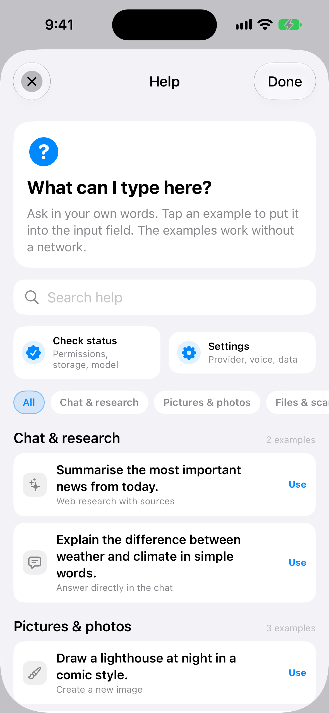
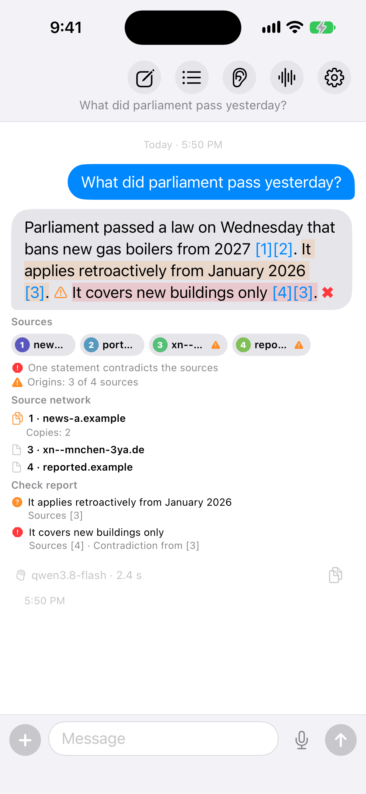
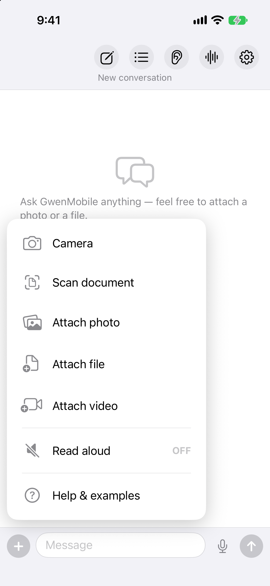
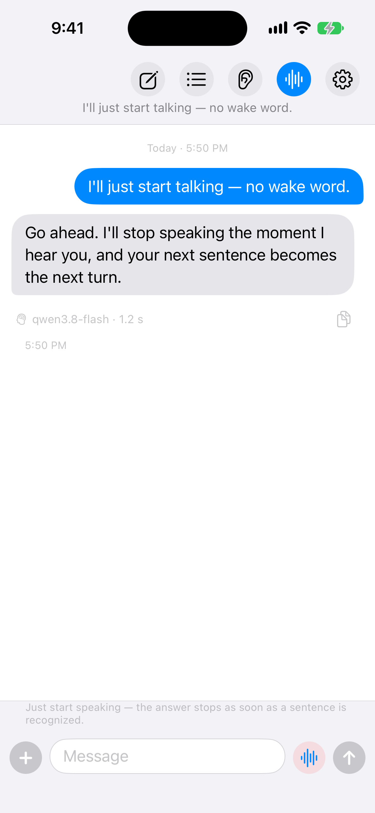

# GwenMobile features

Everything the app does, in detail. For installation and a first overview see the [README](../README.md).

## Chat and conversations
- Streaming answers with formatting, day separators, timestamps, German, English, Spanish or French UI, API key only in the Keychain.
- Every request carries the last 30 messages and up to 10 of their pictures, so a follow-up builds on the
  conversation.
- Auto-scroll follows new entries and pauses while you read higher up; "To the end" jumps back.
- The header holds, from left to right, the pencil for a new chat, the list for the histories, the ear for listening
  mode, the waveform for conversation mode and the gear for Settings.
- "+" opens camera, photo, file, video and read-aloud; the mic and send stay one tap away, Return sends.
- Settings → AI & models → Models → *Thinking depth* picks the level the provider confirms, Settings → Language & appearance → *Appearance* switches Light/Dark.
- Long-press an answer → *Copy answer*, *Save as file* (rendered HTML in `Documents/answers` — Files → On My iPhone →
  GwenMobile → answers — plus the share sheet) or *Delete message*; the copy icon next to the signature line (model,
  seconds, thinking level) takes the raw text.
- One busy indicator waits wherever the app is working — search, price round, file read, calendar, picture
  search — and names the stage; the send button turns into a stop square while an answer streams, the mic records
  or a message with several tasks is running.

## Help and local status
- The help center opens as a sheet over the chat and needs no provider, key or network. Open it from the empty chat
  with *See examples*, from **+** → *Help & examples*, from Settings → *Help & status*, or from an error alert.
- Search filters the examples; the topic chips narrow them to chat and research, pictures and photos, files and
  scans, day and appointments, music and contacts, translating and reading aloud, prices or voice.
- Tapping an example selects a prepared prompt; *Use example* writes it into the chat input and closes the sheet.
  Nothing is sent until the send button is pressed.
- *Check status* reads the local state without a model call: app and iOS version, provider, model and API key,
  microphone, speech, notifications, calendar, reminders, contacts, location, photos, alarms, the optional speaker
  profile, storage, price watches, daily briefing, background refresh and a network row marked as not checked. Each
  row carries a clear OK, attention or problem mark, and the footer says that provider, network and external apps
  were not checked.
- *Settings* jumps back to the app's settings. The error alert keeps the same help entry, so a failing provider never
  hides the explanation.

## Several tasks in one message
- A message can hold as many tasks as you like — "Create two appointments, tomorrow at 11 and the day after at 12,
  then paint the Mona Lisa", or "Who is Natalie Portman? Show me pictures, draw her as a comic and find the nearest
  REWE".
- The message is first split into its single wishes, in the order you wrote them; the same wish said twice in other
  words counts once, several appointments or products count separately. Each wish is then routed on its own.
- The tasks appear in the order you wrote them and share one answer bubble — except when the message contains a
  price round, a translation, music or a call, or two tasks of the same kind (two appointments, two galleries, two
  place lists); then every task gets its own bubble.
- Tasks that need nothing from the others run at the same time and save the waiting: two unrelated questions, a web
  lookup next to a weather card, a clock next to a price round, and several separate pictures — three pictures take
  about as long as one. They also start ahead of a task that builds on another one, so a single picture does not wait
  behind a two-picture chain beside it. The splitter names them, so a task that takes up an earlier task, its answer,
  its picture or its result always waits for it. Every finished picture shows up right away, also while the other
  pictures or a change beside it are still being made — the order of the bubbles stays yours all the same.
  Everything that writes to the device — an appointment, a reminder, a timer, a scan, a call, a message, music, a
  route, read-aloud, the history — and every picture change stays alone and in order.
- Three kinds always come last, in this order: a text message, music, a call. Before them, changing or deleting an
  existing appointment runs after the other tasks, so it also finds an appointment the same message just created.
- A task that builds on the one before uses its result: "paint a red ball, then make the new picture black and white"
  edits the ball that was just drawn, "show me photos … and make the first one black and white" edits the first photo
  found. Every generated picture and every picture of a gallery stays in the chain, so a later edit can still address
  an earlier one. A price round and a translation also hand their result to the following task, and a translation
  with no words of its own translates the answer of the step before it.
- The stop button cancels at once: everything that runs right now is aborted — also the tasks that run side by
  side — the price lookup, the picture being generated or the streaming answer stops there, and the tasks after it
  are left out with a note of how many.

## Research
- "Draw a chart of the population figures" is a picture wish like any other: the picture model draws the diagram
  from the description, and the sources of a research stay in the chat as chips.
- The inline `[1]` markers are tappable and open that source, exactly like the chips under the answer.
- A source chip carries the number of its `[1]` marker and the short name of the site; a long press (iPhone) or
  hovering (Mac) shows the full domain. When more chips arrive than fit the width, that row alone scrolls sideways —
  the chat never grows wider than the screen.
- Before a page is loaded, its address is checked: reported sources, punycode, bare IP addresses, addresses with
  userinfo and plain http are blocked or marked. A flagged chip shows a warning triangle, and a long press offers
  *Report source as wrong* — reported sites stay out of later searches and the report can be withdrawn there.
- Every source arrives with a check line: date, author, the page types the page itself declares (JSON-LD or
  og:type), imprint and whether the page carries paid links. The answer model sees it and names what is missing.
- Before the answer is written, the fetched pages are compared with each other on the device: a page that reprints
  the text of another source counts once, not twice. Such a copy is marked in the prompt as *Duplicate of source
  [1]* so the answer model does not present it as a second confirmation; when every source traces back to one
  origin, the model is told to say so.
- Under the sources a review line counts *origins*, not chips: *Ursprünge: 2 von 3 Quellen* when pages copy the
  same text or belong to the same website, *Nur ein Ursprung* for a single one, *Mehrere unabhängige Quellen*
  otherwise. When copies were found, a *Quellen-Netz* below lists every origin with its copies.
- *Zitate gegen Quellen prüfen* ist optional (Einstellungen → Recherche, Standard: aus): Ist der Schalter an,
  wird jede Aussage der Antwort, die eine Quellenangabe wie `[1][2]` trägt, zusätzlich gegen genau diese Quellen
  geprüft — je Aussage *belegt*, *nicht belegt* oder *widersprochen*. Die Antwort erscheint trotzdem sofort nach
  dem Stream; die Prüfung läuft im Hintergrund weiter, die Antwort zeigt unter den Quellen so lange *Zitate
  werden gegen die Quellen geprüft* und bekommt das Ergebnis anschließend an Ort und Stelle ergänzt. Dadurch
  entsteht keine zusätzliche Wartezeit, und weitere Fragen oder Anweisungen lassen sich schon während der
  Prüfung senden — jede Antwort bekommt ihre eigene Prüfung im Hintergrund, deren Ergebnis in genau dieser
  Antwort erscheint. Ist der Schalter aus, entfällt der Aufruf.
- Ist er an, meldet die Prüfung je Aussage, ob die zitierten Quellen sie stützen, nichts dazu sagen oder
  widersprechen: eine orange Zeile zählt die nicht belegten Aussagen, eine rote die widersprochenen. Ein
  *Prüfbericht* darunter listet nur diese Warnaussagen mit ihren Quellen — vollständig belegte Aussagen stehen
  nicht darin.
- The warning shows up in the answer itself too: the text of a warned statement is tinted orange (not backed) or
  red (contradicted) and a small warning sign follows it — an orange triangle or a red cross. A tap on that sign
  opens the same verdict with the cited sources, so the mark in the answer points at its entry in the
  *Prüfbericht*.
- Asking *about* a picture that is already on screen stays a text answer.

Warnings the answer can spell out:
- On a source chip: a warning triangle for a reported source, a punycode host, a bare IP address, an address with
  userinfo or a plain-http page.
- The review lines under the chips: *Zitate gegen die Quellen geprüft*, *N Aussagen nicht durch die Quellen belegt*,
  *N Aussagen widersprechen den Quellen*, *Ursprünge: X von Y Quellen*, *Nur ein Ursprung*,
  *Mehrere unabhängige Quellen* and *Ohne Quellenangaben im Text*.
- The *Quellen-Netz* below: every origin with the numbers of the pages that copy it (*Abschriften: 2, 3*).
- The *Prüfbericht* below: every warning statement with its sources (*Quellen [1][3]*) and, for a contradiction,
  *Widerspruch von [3]* — backed statements are not repeated.
- In the answer itself: a tinted statement with a small warning sign after it, an orange triangle for *not backed
  by the sources* and a red cross for *contradicts the sources*; a tap on the sign opens the verdict with the cited
  sources.

## Follow-ups understand the conversation
- "and in Germany?" becomes one standalone query — but only when the message cannot stand alone. The rewrite — like
  the router, the research answer, the price round and the appointment planner — sees the six messages before yours:
  the latest answer in full (up to 6,000 characters), the others shortened to 400, so "more on each of them" reaches
  every point.
- A research answer is compact — at most 150 words. When a follow-up asks for more ("mehr Infos dazu",
  "ausführlicher", "genauer", "tell me more", "in detail" …) and is researched again, the answer goes into depth:
  about 80 words for every point the previous answer listed, between 300 and 700 words, each point in its own list
  entry in the same order; where the sources hold nothing new about a point, the answer says so in half a sentence
  instead of padding it. The router marks such a wish with `detail` in its `search_web` call — no phrase list sits
  in the app.
  Measured: "bitte je Meldung mehr Information dazu" after the news from Berlin grew the answer from 131 to 232
  words, the same four points in the same order.
- "Create a picture out of this" folds the previous answer into one prompt, because the image model never sees the chat.
- Pictures are addressed by what they show; if nothing on screen fits, the app says so instead of editing a random one.

## Images
- Your wording decides: make, draw, paint or generate a picture, change one that is already in the chat, or ask
  about a photo.
- Follow-up edits pick up the previous result, up to ten pictures per message; long-press → "Edit" puts a picture back
  into the input bar.
- Viewer: pinch for detail, double-tap, drag to pan while zoomed, swipe or ← → to page (the arrow keys work on
  the Mac).
- "find me all pictures of …" answers with a tappable grid that never enters the model's context; a "+ N more" tile
  shows further hits, "+ N new" searches the next ones, until "End of results".
- *Select* or a long press picks pictures, *All* takes every one; the bar below saves the chosen ones or all of them
  to Photos or shares them. A tile's long-press menu also shares or saves one picture and opens its source page or
  the original. On the Mac: double-click opens, ⌘-click adds, ⇧-click picks a range, ⌥-click saves one, and ⌘A, ⌘S
  and Esc select all, save and cancel.

## Videos
- Three jobs, one menu: **+** → *Attach video* reads a video you already have; a sentence such as "Create a 10-second
  video of the Eiffel Tower at sunset" produces a new one; and an instruction such as "Make it clay style" or "Only the
  woman should say …" changes the attached video. The app does not look for signal words: the tool router decides
  from the wording and the conversation whether a wish is a video question, a new video or an edit.
- **Understanding an attached video:** the picker accepts MP4, MOV, M4V, WEBM, MPEG and MPG up to 20 MB. One video
  is active at a time, and a newer attachment replaces it. The video goes to the model chosen under Settings →
  AI & models → Models → *Video model* — Qwen Cloud or OpenRouter with a model confirmed for video input — and the answer can cover
  the action, people, places, spoken words, timestamps or a summary. A follow-up keeps asking about the same video
  until another one is attached.
- **Generating a video:** describe the subject, action, look, camera and mood. Settings → AI & models → Models → *Video generator*
  picks the model; the list comes from *Load models from account* and only offers models the provider declares as
  video generators. Generation runs through the selected provider's asynchronous video service — Qwen Cloud,
  OpenRouter or an OpenAI-compatible endpoint — and the app starts the job, polls it while the busy indicator runs
  and downloads the finished file. The provider bills according to its own pricing.
- **Changing an attached video:** with a video attached, an instruction is sent together with the video as its
  reference. The app keeps the source duration and aspect ratio, and the model carries over the people, scene, motion
  and sound as closely as it can. The clip is regenerated, so a frame-for-frame copy is not guaranteed; a spoken line
  or sound follows the instruction where the model supports it. Removing the attachment starts a new, independent
  video again. Qwen Cloud and OpenRouter accept an attached video as a reference; an OpenAI-compatible endpoint
  reports that video editing is not available there.
- A new video carries 2–15 seconds and a format of 16:9, 9:16, 1:1, 4:3 or 3:4. Duration and format come from your
  words when you name them; otherwise the app uses 5 seconds and 16:9.
- The finished MP4 appears in the answer as a file card. Tap it to play it, or tap *Save video* to open the system
  save panel — Files on the iPhone and iPad, a folder of your choice on the Mac. The video stays in the chat after
  saving.
- While a video is generated the busy indicator names the stage; the stop button ends the wait in the app and leaves
  out the tasks after it. A missing video model or generator is reported with a pointer to Settings instead of sending
  the request to a text model.

## Price comparison
- Two doors, one chain: a product photo you ask to find cheaper, or the same wish with no picture at all — "what is
  the cheapest X you can find".
- Several products in one message are compared one after another — "compare the prices of a MacBook Pro 14″ and a
  MacBook Pro 16″" gives one price round per device.
- Inside a price round the label is read as product · brand · price · EAN, and never quoted as a source.
- The country comes from the device unless your sentence really names one; a wish worded as *where you stand* asks
  for your location once and falls back to the device region when refused.
- Shops are chosen by content, not by blocklists: six pages read, four kept, one per store, every offer cited under
  **Offers**. No usable page reports that no offer was found instead of calling the label price a bargain.

## Price watch
- A wish with a target price — "tell me when the PlayStation 5 falls below 400 €" — becomes one `watch_price` call of
  the tool router; the app matches no keyword. Its actions are create, update, delete, check and list, and the router
  picks them from the sentence in every supported language and from voice input the same way.
- Creating runs one price round straight away over the same shop, source and offer chain as the comparison, and the
  answer carries a card with product, target, best price, shop and a tap that opens the offer.
- Every watch keeps its own interval (a daily default, or the cadence you name) and can be paused. The checks run in
  the background (`BGAppRefreshTask`) and are caught up at the next app start; each one uses your own key.
- Only a real hit speaks: one local notification and, while the app is in the foreground, a chat answer with the same
  card. The same price never notifies twice; a further drop does.
- Settings → Services → *Price watch* lists every watch with goal, current price, status and last check, and offers pause, check
  now and delete.

## Daily briefing
- A wish for the whole day — "What is on today?", "Summarise my day", "What is important tomorrow?" — becomes one
  `day_briefing` call of the tool router; the app matches no keyword. The router decides only the day, and only from
  the user's own words.
- The card puts together what is already on the device: the appointments of the day, the weather (with the same
  advice as the weather card), the travel time to the next appointment through Apple Maps, open and overdue
  reminders, and birthdays from the contacts. Nothing is invented and nothing is guessed; a source that fails or is
  refused is simply left out.
- The tabs *Today* and *Tomorrow* refetch through the same chain and update the message in place; an appointment row
  opens Apple's event sheet. The answer text is the briefing in one piece and is read aloud like any answer.
- Settings → Services → *Daily briefing* schedules one local notification at the time you choose (rebuilt each time the app
  opens) and switches weather, reminders, birthdays and travel time on or off for the card.
- **Read aloud** on the card speaks the briefing while you get ready.

## Code as a file
- "Tetris as a single HTML file" is answered as code (HTML, CSS, JS/TS, Python, Swift, SQL, JSON …), and editing
  code already in the chat uses the same tool.
- The card streams monospaced with language and line count in its header, scrolls both ways and follows the newest
  line downwards only, so indentation stays readable.
- **Download** lets you pick the folder, **Share** hands the file to the system sheet — both named after your question;
  the copy icon takes the code, and an HTML file gets **Preview** in a real web view, so a game runs on the phone.

## Files, PDFs, Word documents and RTF
- *Attach file* takes PDF, RTF, DOCX, TXT, MD, CSV, JSON — five per message, 20 MB each; the card shows pages, size and read
  characters, and long texts are trimmed visibly.
- Reading happens on the device and only that text goes to the model; the answer names the file in a chip (with its
  page range) and a green badge says how the text was read (PDFKit, RTF, DOCX, OCR, plain). Tapping the file card in your
  own message opens the file.
- On the Mac, drag a PDF, RTF, DOCX, TXT, JPG, PNG or TIFF from Finder straight into the chat: the app reads the file
  or picture on the device and sends the analysis request by itself, so the answer arrives without typing or a further
  tap. The "+" menu keeps working as before — pick, then send.
- CSV and JSON are read as text on the device and answered in the chat.
- Screenshots and photos are OCR'd on the device (Settings → Memory & data → Files) and stay inside the session; tapping the OCR card
  hands the recognised text to the share sheet as a file.

## Document scanner
- "Scan this invoice", "Scan the receipt", "Scan the authority letter" or "Scan the deadline as a reminder"
  becomes one `scan_document` step of the tool router — no scan signal word is matched in the app; the router decides
  from the sentence in every supported language (German, English, Spanish, French) and from voice input the same way.
  The app opens the document camera right away: on the device VisionKit builds a multi-page scan, on hardware
  without it the normal camera is the fallback.
- The pages are read on the device (Vision OCR) and only the recognised text goes to the model. The finished scan
  becomes a PDF in the app's file store and is attached to the message that asked for it, so the chat shows the
  document card with pages and size and the green OCR badge; a tap opens the scan and the answer's file chip names
  it. The summary and the document card stay in the chat, so a follow-up question has the answer at hand.
- The kind in the user's words steers the analysis: an invoice is summarised with sender, amount and due date, an
  authority letter with all deadlines and legal remedies, a receipt with every single item and a check of its bill,
  a letter as a summary. Nothing is invented — without readable text the app says so instead of guessing. The answer
  follows the language of the request.
- "Scan the deadline as a reminder" or "scan the warranty as a reminder" saves nothing by itself: after the scan the
  answer carries a button below it with the title and the date read out of the document, and only a tap on that button
  creates the reminder through the same `plan_reminder` path — the chip that opens the Reminders app then replaces the
  button. A message that pairs the scan with such a reminder wish ("scan the authority letter and keep the deadline as
  a reminder") lands on the same button instead of creating anything automatically, whichever of the two the router
  names first. A scan whose instruction asks for nothing else keeps the camera closed on the second router pass and
  only analyses the document.
- Very long scans are trimmed to the same character budget as attached files, more than a hundred pages are not
  taken over, and the document card says so ("trimmed to …"); the model is then told that the omitted part was never
  read instead of inventing content.
- The "+" menu offers *Scan document* for the open chat as well and runs the same flow.
- Every scan is also written as a PDF into the app's `Downloads` folder, which the Files app shows under *On My
  iPhone → GwenMobile → Downloads* (file sharing is on for the app's documents); that copy stays even when the chat
  is deleted, and a second scan with the same name never overwrites the first. Under the answer the PDF card carries a
  **Share** button that hands the stored PDF to the system share sheet (AirDrop, Mail, Messages, *Save to Files*), so
  the document can be forwarded straight from the chat.

## Translating
- Asking to translate text that is inside a picture or a file goes to the model — with one of them in play the words
  can only come from it.
- With neither in reach the iPhone translates on its own, a bare *translate that* taking the previous answer, and the
  signature line says which of the two produced the text.

## Sharing, histories and storage
- Long-press a generated picture → **Save to Photos**, AirDrop or **Edit**; a photo you attached yourself offers
  AirDrop. AirDrop sends the stored JPEG, not a re-encoded thumbnail, and **Save to Photos** under an answer saves all
  of its pictures at once.
- "Histories" lists conversations with date, message and image count and size on disk: tap to open, swipe to delete one,
  long-press a message to delete exactly that one.
- Every deletion shows how much space it freed and can be undone for 5 seconds from the bar above the chat input.
  "Delete all histories" (top right in the histories, or Settings → Memory & data → Storage) names the counts and megabytes first;
  Settings → Memory & data → Storage shows the same numbers.
- Stored chats that cannot be read are kept as a backup copy in the app's storage, and the app says so; whatever
  could be salvaged is shown.
- Deleting the history also works by voice: the tool router decides from the message and calls `delete_history`,
  which removes every saved conversation and the one that is open right now and leaves an empty chat. No fixed
  signal word is matched in the app; Settings → Voice & speech → Voice control lets you set your own delete-history phrase, which
  only travels into the router prompt as a hint. The deletion uses the same undo path as the history list and the
  answer points at the undo bar. When the same message holds further tasks, they write into the empty chat that the
  deletion leaves behind instead of into the removed conversation.

## Weather and everyday advice
- "Wie wird das Wetter morgen in München?" or "Brauche ich morgen einen Schirm?" becomes one `tell_weather` step of
  the tool router with the place in the user's own words (empty for where they are). For the day the model names an
  absolute date (`date`, computed from today) and counts relative days from today as a cross-check (`dayOffset`:
  heute 0, morgen 1, übermorgen 2, "in four days" 4); the app derives the day from the date, checks the count
  against it and logs a difference. The forecast comes from Open-Meteo (no API key; attribution in the
  card) and the answer comes as a card in the chat.
- The card shows the temperature curve, the rain probability as bars, UV index, wind and gusts, the weather symbols
  of the day and a coloured advice block: severe weather, wind warning, umbrella, heat, sun protection or "no
  special advice" — computed in the app from fixed thresholds, never by the model. All numbers come only from the
  forecast, so nothing is invented. Rain advice names the hours it applies to and comes in two steps: the umbrella
  from a rain probability of 40 % or expected rain of 1 mm with 30 %, otherwise the softer "Regen möglich" from
  25 % or 0.3 mm — a dry day with 0 % gets no umbrella. Sun protection follows the official UV index: nothing below UV 3,
  advice from 3 with the window, and stronger wording from 6 and 8 (uv-index.de/BfS and the US EPA scale) — the
  temperature never triggers it.
- The answer text leads with the most important advice and is read aloud through the existing read-aloud path, so an
  umbrella, wind or heat warning arrives by voice too; the text names the real date the user asked for ("in four
  days" becomes that weekday and date, not always "tomorrow"). The card's day switch follows the request: today, the
  asked day and the day after it, with the asked day selected; a tap on the curve or a bar shows that hour's values,
  and a button exports the card as a PNG through the share sheet.
- Without a place the app uses the device location (`Places/LocationFix`) or says that a place is missing; a
  misspelled place is corrected through Apple's geocoder before the forecast and the answer names the corrected
  place. Official severe-weather warnings are not part of Open-Meteo; the card footer says "forecast, not an
  official warning".

## Calendar control
- Create, change and delete appointments from chat, with real notifications and relative dates; each action is
  confirmed with the appointment data. A "notify me before" belongs in the appointment's own alerts and a reminder
  keeps a due time without an end; when one wish is answered with both a calendar call and a reminder call, the app
  asks the router again with that rule and keeps what the model then chooses — the decision stays with the model.
- The capsule under the answer opens Apple's own event sheet inside the app; its context menu jumps to Calendar.
- The model picks among your real calendar names — a missing one files into the iOS default calendar, an unknown name
  is reported — and a delete only ever touches an appointment whose title carries your words.
- An appointment without a name is filed as "Termin" (German) or "Appointment" (English); several appointments in
  one message are created one by one, each at its own time.

## Reminders, shopping lists, timers and places
- "Remind me tomorrow at nine about the dentist", "put milk and bread on the shopping list", "tell me at REWE
  that I wanted milk" and timers ("set a timer for ten seconds" or "for ten minutes") become one `plan_reminder`
  step of the tool router — there is no list of trigger words; the router decides from the sentence, and
  everything that is not a reminder (appointments, the time, music) stays with its own tool.
- The reminder carries what the sentence says: title, list, due date or duration, all-day, repetition
  (daily/weekly/monthly/yearly, every n), priority, notes and a place with arrival or leaving as its trigger.
  Reminders that share the same place and time are joined into one with all their things in its title
  („Brot kaufen, Butter kaufen, Kaffee kaufen“), so arriving there shows one notification — things for other
  places or other times stay their own reminders.
- Lists are your real Reminders lists: a named one is matched by its title, a missing one is reported with the
  names that exist, and without a name the item goes to your iOS default list — shopping items therefore land on
  your own shopping list.
- A place is resolved on the device: first the nearest real match through Apple Maps (the next post office, the
  next REWE), then Apple's geocoder for a city or an address; the point becomes a location alarm — 150 m around a
  shop, a city up to a few kilometres wide — so iOS tells you when you arrive or leave; a place that cannot be
  found is reported instead of silently dropped.
- "What is on my shopping list", "tick milk off", "move the dentist to eleven" and "delete the dentist" are the
  same tool with `list`, `complete`, `update` or `delete`; the app finds the reminder by your own words and never
  touches one it cannot match.
- Every action is confirmed with the reminder data and a capsule that opens the Reminders app; without reminders
  access the app says so and sends you to Settings. A device without any reminder list gets the default one
  created on the first reminder instead of an error.

## Timers
- "Set a timer for ten minutes" or "stelle einen Timer auf 10 Sekunden" starts the iPhone's own timer through
  AlarmKit (iOS 26+): it counts down, rings and lights up on the Lock Screen even when GwenMobile is closed.
  On older systems a local notification with the same duration takes its place.
- The model decides through the `set_timer` tool: only an explicit timer wish goes there. "Remind me in ten
  minutes" stays a reminder, an appointment stays an appointment, and the time of day stays a clock answer.
- The confirmation names the title and the duration ("⏱ Timer gestellt: Tee für 10 Sekunden"); no list entry and
  no reminder is involved.

## Places and routes
- "Nearest …" lists up to three addresses of a kind around you; a route finds the destination you named and needs no
  location. Both use Apple Maps — no token, no quota.
- Every entry is a chip with name, distance and travel mode; tapping hands the route to Maps in the mode you mentioned.
- A route also asks Apple Maps with your own sentence, next to the search terms the AI suggests, and the hit whose
  name and address contain the most of your words leads — "Frankfurter Straße 34 Berlin" is found even when the
  AI suggests another street (it did in eleven of fifteen measured runs). Apple Maps cannot read a whole sentence for
  places nearby, so there the AI has to name the place: when none of its search terms is made of your own words
  (REWE turned into "supermarket"), GwenMobile asks it again, at most twice. Places whose names match your words then come
  before closer ones of other names; a wish without a name ("somewhere to eat") stays nearest first. The comparison
  is letter by letter, with no language-specific word lists. A route and a nearby search in one message keep their
  own headed blocks in the same answer.

## Phone calls
- "Please call family: mother", "Ruf Mama an", "Call my brother on his mobile" become one `call_contact` step of the
  tool router — there is no list of trigger words in the app; the router decides from your sentence, questions about
  calls ("what does a call to Italy cost") stay answers.
- The router passes who is meant (name, nickname or form of address), a named contact group, the relation
  (mother, brother, …) and which number (mobile, home, work, main). The contacts themselves are read on the device
  and never sent to the AI.
- Resolution on the device: exact names and nicknames first; the relations on a contact card ("mother: Maria
  Muster") and their localized labels; a named group narrows the choice, an unknown group is mentioned but does not
  block the call. Mobile numbers win unless you asked for another one. Two contacts that fit are listed, a name that
  only sounds similar ("Anna" for "Anja") is asked back, numbers with `*`, `#` or letters are never dialled.
- A message with several wishes runs the call last, and only one call per message.
- Free Apple ID: the call is handed to iOS with a `tel:` link, iOS asks once. Paid membership with
  `GWEN_DIALER = YES` on iOS 26 in the EU: LiveCommunicationKit starts the cellular call itself, without a prompt once
  GwenMobile is the default dialer app; if that fails the `tel:` link steps in.
- Phone numbers that appear in an answer are tappable: the system prompt asks the AI to write them as `tel:` links,
  so it can also mark short codes and numbers without a leading zero; `PhoneLinks` additionally spots unmarked
  numbers on the device. A tap runs the same way as a spoken call request — hands-free with the dialer entitlement,
  otherwise the `tel:` prompt — and posts the usual call line. Dates, prices and postal codes stay plain text.

## Conversation mode
- Conversation mode is switched in Settings → Voice & speech → *Voice control* or with the waveform button between the ear and the
  gear in the chat header. It is separate from the wake-word listening mode; switching one on switches the other
  off. The microphone stays open while the AI streams and reads aloud, so you can talk over it like in a normal
  conversation.
- As soon as a sentence or a longer word is recognized, the answer stops at once, the part already streamed stays
  in the chat, and your sentence becomes the next turn after the silence set under *Silence before sending* (default
  4 s). The next answer builds on the partial answer that stayed visible.
- A single short word (no second word and fewer than five letters) is ignored and discarded. The device tests showed
  why: without that threshold the recognizer turned the app's own speech or silence into words such as *Und*, *Ich*
  or *Bist*, and the AI interrupted itself. A sentence such as *Moment, ich habe eine Frage* stops the answer; a
  lone *Stop* does not. The configured cancel word is matched before this threshold, so a short cancel word works too.
- If you say the configured cancel word, the running answer or task is cancelled at once, the cancel word is not sent,
  and the app only speaks *Understood.* in the app language. The configured stop word has no special
  meaning in conversation mode; it becomes part of the utterance like any other words.
- Echo cancellation runs on the microphone input, so the app's own voice is largely removed. Headphones are the
  most reliable choice; if the echo protection cannot be enabled, the mode switches itself off with a message.
- *Only my voice* (Settings → Voice & speech → *Voice control*, off by default) checks a local voiceprint before conversation mode
  reacts. Enroll three short recordings once; afterwards another voice neither interrupts the answer nor becomes a
  turn, and the cancel word also has to match the enrolled voice. The voiceprint stays in the Keychain on this device,
  raw recordings are discarded, and the check is a probability, not a secure login. Without a profile the mode does
  not start in this setting.
- The microphone stays held while the mode is on, so it keeps working in the background like listening mode; the
  screen stays awake in the foreground. Settings or the histories pause it. There is no fixed listening time: the
  mode keeps listening until you switch it off, the microphone is lost or the echo protection fails.

## Voice
- The mic transcribes live on the device (`SpeechAnalyzer` from iOS 26, `SFSpeechRecognizer` before) and shows the
  words above the input bar, with the stop and cancel word as a hint below. Ending the sentence with the stop word
  (*Jetzt senden* / *Send it now*) sends it at once, the cancel word (*Jetzt abbrechen* / *Cancel that*) discards it;
  otherwise it is sent after the silence set in Settings (default 4 s), at the latest after the maximum set there
  (default 3 minutes) — the last ten seconds count down. The
  very first use on iOS 26 downloads Apple's speech model once.
- Listening mode is switched in Settings → Voice & speech → *Voice control* or with the ear button between the histories and Settings
  in the chat header: blue while on, one tap switches it and a short notice says *Listening mode on* / *off*; button
  and switch are the same setting, so both always agree. Without a configured provider the tap opens Settings;
  switching off always works. While the app is open, a rainbow glow along the screen edges appears when the wake
  word starts a request and stays while it is recorded; it goes out as soon as GwenMobile confirms that the request
  went to the AI (the falling tone) or the input time ends, and switching the mode on alone does not show it.
  Switching to another app or locking the iPhone ends the glow and a Live Activity takes over in the Dynamic Island
  or on the lock screen; returning to the app or switching the mode off dismisses it.
- It listens continuously for the wake word (*Hey Computer*), confirms it with a randomly chosen spoken phrase
  (*I hear you* / *Yes?*, localized), takes what follows as the request and plays a falling tone once the request
  is sent by the stop word or the pause — before the AI starts. As in conversation mode, the microphone runs with
  echo cancellation, so GwenMobile's own confirmation and read-aloud output do not become input; headphones are the
  most reliable choice. The spoken confirmation is also removed from the request if the microphone still picks it
  up. It pauses normal recognition while an answer runs or is read aloud and while Settings or the histories are
  open; during a run or read-aloud only the configured cancel word is heard, and it cancels the answer. Conversation
  mode is the separate mode described above: it needs no wake word and keeps listening through an answer.
- The wake word also works when spoken quietly: the held microphone lifts quiet speech towards a comfortable level
  before it reaches the recognizer (at most twelve times its level, loud speech and digital silence stay untouched).
- If the whole request is the new-chat word (default *Neuer Chat*, *Neue Session*, *New chat*, *New session*), it
  opens an empty chat instead of asking the AI — an already empty chat is kept, typed text stays in the input.
- If the whole request is the listening-off word (default *Zuhören beenden*, *Zuhörmodus aus*, *Stop listening*;
  English *Stop listening*, *Listening off*), listening mode switches off and the microphone is released; from the
  background a notification says so. Measured on the iPhone: every default word is recognized after "Hey Computer",
  a sentence that only mentions stopping to listen is not.
- All five words — wake, stop, cancel, new chat, listening off — can be changed in Settings → Voice & speech → *Voice control*; the
  new-chat and the listening-off word take several variants separated by commas. Words of four letters or more
  tolerate one misheard letter.
- Reading answers aloud is switched by voice through the tool router: "schalte vorlesen ein" or "mach das vorlesen
  aus" becomes the `set_read_aloud` step — no command word is baked into the app. Switching it on confirms itself
  aloud ("🔊 Vorlesen ist jetzt an"), switching it off confirms in the chat only; the manual switch also sits in
  the "+" menu next to the camera and file items.
- "Lies mir die Antwort vor" or "read that to me" reads the answer out loud once through the `read_answer` step —
  also while reading aloud is switched off, and without flipping the setting; in a chat without an earlier answer it
  answers that there is nothing to read yet. The step keeps its place in the message: after a new answer it reads
  that answer, before another task it reads the answer that stood in the chat before the message.
- The microphone itself stays on between requests, so a mode switched on in the foreground keeps working after you
  change to another app (audio background mode): the answer is then read aloud even if read-aloud is off, and posted
  as a notification. The microphone indicator stays on, the open app keeps the screen from locking. When you come
  back to the app or the audio device changes (a headset comes or goes), the wake-word session starts fresh, so
  listening keeps working. iOS does not
  allow starting the microphone from the background — if a phone call, Siri or a route change ends it and it cannot
  be resumed, a notification asks you to open GwenMobile, which then listens again. If the speech recognition fails,
  the mode switches itself off and says why.
- A connected Bluetooth headset (AirPods) becomes the microphone and the output: from iOS 26 GwenMobile asks for
  full-bandwidth Bluetooth recording, which only certain AirPods support; all others fall back to the hands-free
  profile, which makes other audio sound like a phone call while the mode is on. If another device such as the Mac
  takes the AirPods, GwenMobile keeps listening through the iPhone and leaves them there — a mere re-listing by iOS
  while the Mac keeps playing does not pull them back; only a real reconnect (they disappeared from the available
  inputs in between, for example after a trip into the case) may bring them back to the iPhone.
- The sound when the request is understood can be replaced by a system sound of the device (Settings → Voice & speech → *Voice control*
  → *Sound when the request is understood*): the list is read off the device itself
  (`/System/Library/Audio/UISounds` on the iPhone — 341 sounds measured on iOS 27 —, `/System/Library/Sounds` on the
  Mac), tapping one plays it once, and a sound that cannot be played falls back to the GwenMobile tone.
- Siri: *"Hey Siri, Gwen hör zu"* (English: *"Hey Siri, Gwen listen"*) opens the app and starts listening. "Gwen" is
  registered as an alternative app name, so *"Hey Siri, Gwen"* is offered as a phrase too — whether Siri then starts
  listening or only opens the app is decided by iOS. `gwenmobile://listen` from the Action button or Back Tap does the
  same.
- Your own Siri word: the *Listen* action (German: *Zuhören*) is available in the Shortcuts app, so a shortcut with
  any name — "Jarvis" — makes "Hey Siri, Jarvis" start listening. Settings → Services → *Your own Siri command* opens Shortcuts
  on GwenMobile's actions and explains the steps.
- Read-aloud: "+" → *Read aloud* switches it on or off for every answer (the menu shows ON/OFF); Settings →
  Voice & speech → *Output voice* lists the installed voices of the app language and any *Personal Voice* created in iOS after
  permission, and source markers are skipped. While the voice speaks, the "+" turns into a stop square.
- **Personal Voice:** a voice created in iOS under Settings → Accessibility → Personal Voice appears under
  Settings → Voice & speech → *Personal Voice* after GwenMobile has asked for permission. Once selected it is used for
  read-aloud, the spoken wake confirmation, the cancel feedback and the briefing like any other output voice. The
  voice is created and stored by iOS; GwenMobile only receives permission to use it and never uploads it. It is not
  the Voice profile for *Only my voice*, which recognizes the speaker on input. Apple currently supports English
  (U.S.), Mandarin Chinese (China mainland) and Spanish (Mexico), not German; when the voice language differs from
  the app language, the app shows a hint. *Check again* refreshes the list after creating the voice, after the iOS
  processing finishes or after turning on *Allow Apps to Request to Use*.

## Text messages
- "Schreib Mama, dass ich später komme", "Schick Peter eine SMS: bin gleich da" become one `send_message` step of
  the tool router with the recipient (name, group, relation) and the text as it should arrive — reported speech is
  turned into the message itself. No trigger words in the app.
- The recipient is resolved on the device exactly like a call (mobile number first, asking back when two contacts
  fit); a wish without text is asked back instead of sending an empty message.
- Free Apple ID: the Messages form opens with recipient and text, you tap Send. Paid membership with
  `GWEN_MESSAGING = YES`, iOS 26 and GwenMobile as default carrier messaging app: the SMS is sent directly; if that
  way is not set up, the form steps in — never a second copy after a failure.
- The form needs GwenMobile in the foreground: asked from the background (listening mode with the screen locked), the
  answer asks you to open the app and say it once more.
- A message with several wishes sends the text after the others and before music and a call.
- The message keeps the language you spoke it in: the device compares both languages and asks the router again when
  they differ; a text that still differs is shown in the Messages form instead of being sent unseen.
- The answer names the recipient and the text; the text itself never goes into the trace.

## Music
- "Spiel Musik", "Spiele meine Playlist Sport", "Spiel Hello von Adele auf Spotify", "Nächstes Lied", "Musik aus"
  become one `control_music` step of the tool router with action (play, pause, resume, next, previous), what to play,
  the artist, its kind (song, artist, album, playlist) and the service when you named one — no trigger words in the
  app. Questions about music (who sings it, the lyrics) stay answers, pictures of an artist stay a gallery.
- Which service: the one you named; for a title the default service from Settings → Services → *Music*; for a command the
  service that is playing, then the one GwenMobile used last, then the default.
- Apple Music: your own library first (playlists, artists, albums, songs, compared word by word), then the catalog via
  Apple's public iTunes search (country of the device, about 20 requests a minute); the Music app plays it through
  `MPMusicPlayerController.systemMusicPlayer`. Catalog titles need an Apple Music subscription — the answer says so
  when the Music app refuses.
- Spotify: login with Spotify's iOS SDK (PKCE, the session lives in the Keychain and is renewed on its own), search
  and your own playlists via the Web API (at most 10 hits per search in development mode), playback through App
  Remote while GwenMobile is open — Spotify is woken with a short app switch if it is not running — and through the
  Web API from the background.
- A message with several wishes runs the music after the others and before a call; a started title is not read
  aloud over the music.

## Time and date
- "Wie spät ist es?", "Welches Datum haben wir heute?", "What time is it in New York?" become one `tell_time` step
  of the tool router; the router only names the place and its time zone, the time itself comes from the device clock
  — exact to the minute and with the date that belongs to that place.
- A question that has to work out another day or a duration (when Easter is, how many days until Christmas) stays an
  answer; the chat model now also receives the local time and time zone, so it can reckon from there.

## Personal memory
- "Merk dir, dass ich kein Fleisch esse" or "Remember that I drink oat milk" becomes one `remember_fact` step of
  the tool router with `action: create`; the model writes the fact as one timeless sentence and turns relative time
  ("5 months ago") into an absolute `date`. The app stores it locally in
  `Library/Application Support/memory.json` (file protection, no account, no server) and answers with a
  confirmation that carries the entry as a chip.
- `action: suggest` is a durable fact the user only stated in passing: the app asks first ("Should I remember
  this?") and stores it only after the user taps *Save*. `action: forget` removes a catalog entry by its key,
  `action: list` answers what is known about the user.
- Every router call carries a compact MEMORY CATALOG of the stored facts with stable keys; `answer_in_chat` can copy
  the keys whose facts help the question into its `memory` field. Only those entries travel to the answering model
  as a PERSONAL MEMORY block, marked with anchor and due date — never the whole list and never anything in an
  unrelated question. The answer shows the used entries as chips under its sources.
- Routine check-ups can carry an `intervalMonths` (a dental check-up 6, a tetanus booster 120); the app shows the
  next due date as a rule of thumb. Due reminders become a local notification on the next app start once the user
  has switched *Reminder for the due date* on for that entry; nothing is sent without that confirmation.
- Settings → Memory & data → *Memory* holds the master switch, suggestions, the used-memory chips, retention (always, 12, 3 months)
  and the *About me* list: search, add, edit, pin, delete, export as JSON and delete all. Every entry is visible,
  changeable and removable; the setting footer names where the data stays.

| Probe | What it measures |
|---|---|
| `memoryroute` | Fixed tool calls through decoding: create, suggest, forget, list, a broken call, the chosen answer keys, the plan shape and the catalog inside the system block — `memory_route.txt` |
| `memorystore` | A temporary store on the device: persistence, due date and reminder, block, catalog, unknown keys, usage counter and delete — `memory_store.txt` |

## Settings
- The start page groups the configuration into *AI & models*, *Voice & speech*, *Language & appearance*, *Memory & data*, *Services* and *Help & status*; each opens a focused page. *Test connection* sits at the bottom of the start page.
- Settings → Language & appearance → *Language* switches the interface between German, English, Spanish and French and starts from the system language.
- *Local (iPhone)* runs MLX models inside the app. The local model screen shows the installed models and searches
  Hugging Face for public MLX/safetensors chat checkpoints with a supported architecture; the only filter is whether
  the model fits the iPhone's RAM. A downloaded model stays on the device, works offline and can be activated as
  chat or vision model. There is no fixed catalog, no key and no server. Text-only models are chat-only; tool
  calling is experimental for dynamic models. On 8 GB, E4B and Qwen 9B are hidden by the RAM filter. The technical
  details are in [DEVELOPMENT.md](DEVELOPMENT.md#hugging-face-mlx-browser).
- Qwen Cloud (with its billing type and region), any OpenAI-compatible server, OpenRouter or DeepSeek, each with
  its own Keychain key; OpenRouter and DeepSeek also show the remaining credit after *Test connection*. Models come
  from the provider's model list via *Load models from
  account* (the photo-model picker lists only confirmed image input). The **Features** row shows for the chosen
  provider whether Chat · Vision · Images are available (green), checked while loading the models (orange) or
  missing (grey) — an OpenAI-compatible server has no picture model, so pictures need Qwen Cloud or
  OpenRouter; a missing feature greys out its model row.
- Dictation and read-aloud always use iOS system services. On the Mac: ⌘Q writes the pending chat save before exiting,
  Settings → Language & appearance → *Language* → *Open at login* registers a login item.
- *Voice control* holds both speech modes — listening mode with a wake word and conversation mode without a signal
  word — plus the words, silence and cue sounds.
- *Help & status* opens the offline help center; its *Check status* uses the same local `AppStatusReader` as
  the chat status, but without a model call.
